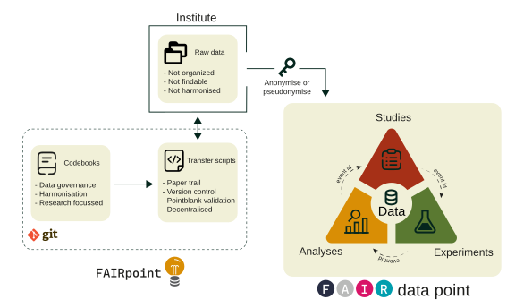

# Start here: Harmonizing data with beFAIR

## What is beFAIR?

Running a multi-study research platform means dealing with data in
different formats, naming conventions, and structures across studies.
beFAIR solves this by providing a shared, codebook-driven framework for
collecting and **harmonizing** clinical research data into a single SQL
database — following the [FAIR data
principles](https://www.go-fair.org/fair-principles/).

FAIR stands for:

- **F**indable — data and metadata are easy to discover
- **A**ccessible — data can be retrieved with standard protocols
- **I**nteroperable — data uses shared vocabularies and formats
- **R**eusable — data is well-described and can be reused across studies

beFAIR achieves this by combining a **codebook-driven schema** with
auto-generated ETL scripts. Every table in the database is defined by a
codebook (a YAML file specifying variable names, types, and validation
rules). Scripts are drafted automatically, leaving you to fill in only
the study-specific data mapping logic.



### The three data pillars

A FAIRground is organized around three data pillars:


#### [Study](https://koenastam.github.io/beFAIR/articles/adding_a_study.md)

`studies/`

Clinical trial metadata — participants, study arms, scheduled events,
and the ID mapping that links source identifiers to anonymised
participant IDs.


#### [Experiment](https://koenastam.github.io/beFAIR/articles/adding_an_experiment.md)

`experiments/`

Laboratory measurements on participant samples — e.g. CyTOF, ELISA,
Olink, and flow cytometry.


#### [Analysis](https://koenastam.github.io/beFAIR/articles/adding_an_analysis.md)

`analyses/`

Processed or derived results computed from study and experimental data.

Each pillar lives in its own subdirectory and contains one or more **ETL
scripts** alongside a `meta.yaml` describing the dataset and a `data/`
folder pointing to raw source files.

### The codebook system

Every database table is defined by a **codebook** — a YAML file that
describes each variable: its name, data type, allowed categories, and
validation rules. Codebooks are the shared vocabulary that makes data
comparable across studies.

Here is an example for the `age` variable in the `participant` codebook:

``` yaml
age:
  description: Age of subject at enrollment; in years. Usually an integer, but
    decimals are allowed for newborns (e.g. 0.2).
  units: years
  type: numeric
  type_sql: DECIMAL
  categories: ~
  labels: ~
  validations:
    - col_is_numeric: []
    - col_vals_between:
        left: 0
        right: 120
        na_pass: true
        label: "Age in years should fall within specified range"
```

beFAIR ships with built-in codebooks covering all standard study,
experiment, and analysis tables. For assays or schemas unique to your
project, you can also place custom YAML codebooks in the `codebooks/`
folder inside your beFAIR project directory — they are treated
identically to built-in ones. See the [Codebook configuration
guide](https://koenastam.github.io/beFAIR/articles/codebook_configuration.md)
to learn how to read, write, and add custom codebooks, and the [Codebook
reference](https://koenastam.github.io/beFAIR/articles/codebooks_reference.md)
for the full list of available built-in codebooks and their variables.

------------------------------------------------------------------------

## How beFAIR works

Depending on your role, beFAIR will mean something different to you.

### I want to use data from the database

The database is already populated and you want to query or retrieve
data. Connect to the database using
[`FAIRgroundConnect()`](https://koenastam.github.io/beFAIR/reference/FAIRgroundConnect.md)
with your institutional DSN, then use standard `DBI` calls to read
tables.

``` r

FAIRgroundConnect("LUCID_FAIRPOINT")
con <- FAIRgroundConnection()

DBI::dbReadTable(con, "participant")
```

To pull all tables related to a specific study, experiment, or analysis
ID — following relationships across all three pillars — use
[`collectTablesById()`](https://koenastam.github.io/beFAIR/reference/collectTablesById.md):

``` r

collectTablesById(con, id = "CHSI1")   # returns a named list of all linked tables
```

See the [Database smoke
test](https://koenastam.github.io/beFAIR/articles/database_smoke_test.md)
for a worked example of connecting and inspecting the available tables,
and [Exploring and joining data
tables](https://koenastam.github.io/beFAIR/articles/exploring_and_joining_data_tables.md)
for a guide to the available wrapper functions.

### I want to add data by writing ETL scripts

A FAIRground directory already exists and you need to contribute data
for a new study, experiment, or analysis.

``` r

FAIRgroundConnect("LUCID_FAIRPOINT")

addStudy("MyStudy", study_id = "MYST1")       # scaffolds scripts under studies/
addExperiment("MyStudy_CyTOF_exvivo",
              experiment_type = "CyTOF")       # scaffolds scripts under experiments/
addAnalysis("MyStudy_CyTOF_clustering")        # scaffolds scripts under analyses/
```

Each function drafts the required ETL scripts for you. Your job is to
fill in the data-mapping logic. See [Adding a
study](https://koenastam.github.io/beFAIR/articles/adding_a_study.md),
[Adding an
experiment](https://koenastam.github.io/beFAIR/articles/adding_an_experiment.md),
and [Adding an
analysis](https://koenastam.github.io/beFAIR/articles/adding_an_analysis.md)
for step-by-step walkthroughs.

### I am a developer or database maintainer

You are responsible for keeping the database up to date — running ETL
scripts, managing codebook versions, and onboarding new contributors. If
you are setting up beFAIR for the first time, start with [Starting a
project](https://koenastam.github.io/beFAIR/articles/starting_a_project.md).

``` r

FAIRgroundConnect("LUCID_FAIRPOINT")

# Re-run all new or changed scripts and reload the database:
databaseUpdate()

# First-time setup of a new database:
startProject(dir = "/path/to/my/project")
databaseInitialize()
```

[`databaseUpdate()`](https://koenastam.github.io/beFAIR/reference/databaseUpdate.md)
is the main orchestrator — it syncs codebook definitions, detects new or
changed scripts, runs each one, validates the output, and loads it into
the database. See the [Database smoke
test](https://koenastam.github.io/beFAIR/articles/database_smoke_test.md)
for setup and maintenance guides, and [Developer
internals](https://koenastam.github.io/beFAIR/articles/developer_internals.md)
for a deep dive into
[`databaseUpdate()`](https://koenastam.github.io/beFAIR/reference/databaseUpdate.md)
and the registry tables.

------------------------------------------------------------------------

## Where to go next

### Setting up

| Guide | What you will learn |
|----|----|
| [Starting a project](https://koenastam.github.io/beFAIR/articles/starting_a_project.md) | Initialize the project directory, connect to a database, and run [`databaseInitialize()`](https://koenastam.github.io/beFAIR/reference/databaseInitialize.md) |
| [Database smoke test](https://koenastam.github.io/beFAIR/articles/database_smoke_test.md) | Connect via DSN or SQLite, initialize, and verify the registry tables |
| [Developer internals](https://koenastam.github.io/beFAIR/articles/developer_internals.md) | Understand the `table_codebook` and `table_script` registry tables and every function called by [`databaseUpdate()`](https://koenastam.github.io/beFAIR/reference/databaseUpdate.md) |

### Using data

| Guide | What you will learn |
|----|----|
| [Exploring and joining data tables](https://koenastam.github.io/beFAIR/articles/exploring_and_joining_data_tables.md) | Load, filter, and join tables across the three pillars using beFAIR’s wrapper functions |

### Populating data

| Guide | What you will learn |
|----|----|
| [Adding a study](https://koenastam.github.io/beFAIR/articles/adding_a_study.md) | Register a study with [`addStudy()`](https://koenastam.github.io/beFAIR/reference/addStudy.md), complete `meta.yaml`, and fill in the four study ETL scripts (`id_mapping`, `participant`, `studyarm`, `studydesign`) |
| [Adding an experiment](https://koenastam.github.io/beFAIR/articles/adding_an_experiment.md) | Register an experiment with [`addExperiment()`](https://koenastam.github.io/beFAIR/reference/addExperiment.md) and complete the experiment-specific ETL scripts |
| [Adding an analysis](https://koenastam.github.io/beFAIR/articles/adding_an_analysis.md) | Register an analysis with [`addAnalysis()`](https://koenastam.github.io/beFAIR/reference/addAnalysis.md) and complete the analysis ETL scripts |

### Codebook reference

| Guide | What you will learn |
|----|----|
| [Codebook configuration guide](https://koenastam.github.io/beFAIR/articles/codebook_configuration.md) | Understand the YAML codebook format — types, categories, validation rules, and how to add custom codebooks |
| [Codebook reference](https://koenastam.github.io/beFAIR/articles/codebooks_reference.md) | Browse all built-in codebooks and their variables |
