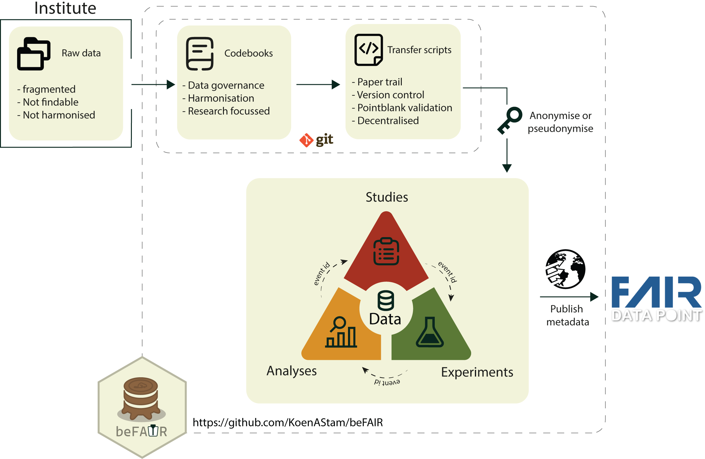

```{r setup, include=FALSE}
knitr::opts_chunk$set(echo = TRUE)
```

## What is beFAIR?

Running a multi-study research platform means dealing with data in different
formats, naming conventions, and structures across studies. beFAIR solves
this by providing a shared, codebook-driven framework for collecting and
**harmonizing** clinical research data into a single SQL database — following
the [FAIR data principles](https://www.go-fair.org/fair-principles/).

FAIR stands for:

- **F**indable — data and metadata are easy to discover
- **A**ccessible — data can be retrieved with standard protocols
- **I**nteroperable — data uses shared vocabularies and formats
- **R**eusable — data is well-described and can be reused across studies

beFAIR achieves this by combining a **codebook-driven schema** with
auto-generated ETL scripts. Every table in the database is defined by a
codebook (a YAML file specifying variable names, types, and validation rules).
Scripts are drafted automatically, leaving you to fill in only the
study-specific data mapping logic.




### The three data pillars

A FAIRground is organized around three data pillars:

```{r pillars, echo=FALSE}
htmltools::tags$div(
  style = "display: flex; gap: 2rem; margin: 1.5rem 0; text-align: center;",
  htmltools::tags$div(
    style = "flex: 1;",
    htmltools::tags$img(src = "images/icon_study.svg", width = "80px",
                        style = "margin-bottom: 0.5rem;"),
    htmltools::tags$h4(htmltools::tags$a("Study", href = "adding_a_study.html"),
                       style = "margin: 0.4rem 0;"),
    htmltools::tags$p(htmltools::tags$code("studies/"), style = "margin: 0;"),
    htmltools::tags$p("Clinical trial metadata — participants, study arms, scheduled events, and the ID mapping that links source identifiers to anonymised participant IDs.")
  ),
  htmltools::tags$div(
    style = "flex: 1;",
    htmltools::tags$img(src = "images/icon_experiment.svg", width = "80px",
                        style = "margin-bottom: 0.5rem;"),
    htmltools::tags$h4(htmltools::tags$a("Experiment", href = "adding_an_experiment.html"),
                       style = "margin: 0.4rem 0;"),
    htmltools::tags$p(htmltools::tags$code("experiments/"), style = "margin: 0;"),
    htmltools::tags$p("Laboratory measurements on participant samples — e.g. CyTOF, ELISA, Olink, and flow cytometry.")
  ),
  htmltools::tags$div(
    style = "flex: 1;",
    htmltools::tags$img(src = "images/icon_analysis.svg", width = "80px",
                        style = "margin-bottom: 0.5rem;"),
    htmltools::tags$h4(htmltools::tags$a("Analysis", href = "adding_an_analysis.html"),
                       style = "margin: 0.4rem 0;"),
    htmltools::tags$p(htmltools::tags$code("analyses/"), style = "margin: 0;"),
    htmltools::tags$p("Processed or derived results computed from study and experimental data.")
  )
)
```

Each pillar lives in its own subdirectory and contains one or more **ETL
scripts** alongside a `meta.yaml` describing the dataset and a `data/` folder
pointing to raw source files.

### The codebook system

Every database table is defined by a **codebook** — a YAML file that describes
each variable: its name, data type, allowed categories, and validation rules.
Codebooks are the shared vocabulary that makes data comparable across studies.

Here is an example for the `age` variable in the `participant` codebook:

```yaml
age:
  description: Age of subject at enrollment; in years. Usually an integer, but
    decimals are allowed for newborns (e.g. 0.2).
  units: years
  type: numeric
  type_sql: DECIMAL
  categories: ~
  labels: ~
  validations:
    - col_is_numeric: []
    - col_vals_between:
        left: 0
        right: 120
        na_pass: true
        label: "Age in years should fall within specified range"
```

beFAIR ships with built-in codebooks covering all standard study, experiment,
and analysis tables. For assays or schemas unique to your project, you can also
place custom YAML codebooks in the `codebooks/` folder inside your beFAIR
project directory — they are treated identically to built-in ones. See the
[Codebook configuration guide](codebook_configuration.html) to learn how to read,
write, and add custom codebooks, and the [Codebook reference](codebooks_reference.html)
for the full list of available built-in codebooks and their variables.

---

## How beFAIR works

Depending on your role, beFAIR will mean something different to you.

### I want to use data from the database

The database is already populated and you want to query or retrieve data.
Connect using `FAIRgroundConnect()` with your DSN, then use standard `DBI`
calls to read tables.

```r
FAIRgroundConnect("MY_DSN")
con <- FAIRgroundConnection()

DBI::dbReadTable(con, "participant")
```

> A **DSN** (Data Source Name) is an ODBC connection string configured by your
> database administrator. For local testing without a server, see the
> [Database smoke test](database_smoke_test.html).

To pull all tables related to a specific study, experiment, or analysis ID —
following relationships across all three pillars — use `collectTablesById()`:

```r
collectTablesById(id = "CHSI1")   # returns a named list of all linked tables
```

See the [Database smoke test](database_smoke_test.html) for a worked example of
connecting and querying the database.

### I want to add data by writing ETL scripts

A FAIRground directory already exists and you need to contribute data
for a new study, experiment, or analysis.

```r
FAIRgroundConnect("MY_DSN")

addStudy("MyStudy", study_id = "MYST1")       # scaffolds scripts under studies/
addExperiment("MyStudy_CyTOF_exvivo",
              experiment_type = "CyTOF")       # scaffolds scripts under experiments/
addAnalysis("MyStudy_CyTOF_clustering")        # scaffolds scripts under analyses/
```

Each function drafts the required ETL scripts for you. Your job is to fill in
the data-mapping logic. See [Adding a study](adding_a_study.html),
[Adding an experiment](adding_an_experiment.html), and
[Adding an analysis](adding_an_analysis.html) for step-by-step walkthroughs.

### I am a developer or database maintainer

You are responsible for keeping the database up to date — running ETL scripts,
managing codebook versions, and onboarding new contributors.

**Day-to-day:** re-run any new or changed scripts and reload the database:

```r
FAIRgroundConnect("MY_DSN")
databaseUpdate()
```

**First-time setup:** create the project directory and initialize the database:

```r
startProject(dir = "/path/to/my/project")
FAIRgroundConnect("MY_DSN")
databaseInitialize()
```

`databaseUpdate()` is the main orchestrator — it syncs codebook definitions,
detects new or changed scripts, runs each one, validates the output, and loads
it into the database. Start with [Starting a project](starting_a_project.html)
for the full setup walkthrough, and [Developer internals](developer_internals.html)
for a deep dive into `databaseUpdate()` and the registry tables.

---

## Where to go next

### Setting up

| Guide | What you will learn |
|---|---|
| [Starting a project](starting_a_project.html) | Initialize the project directory, connect to a database, and run `databaseInitialize()` |
| [Database smoke test](database_smoke_test.html) | Run the full ETL pipeline end-to-end in under a minute using an in-memory SQLite database and built-in dummy data |
| [Developer internals](developer_internals.html) | Understand the `table_codebook` and `table_script` registry tables and every function called by `databaseUpdate()` |

### Using data

| Guide | What you will learn |
|---|---|
| [Database smoke test](database_smoke_test.html) | Connect, run the ETL pipeline, and query a working database |
| Exploring and joining data tables *(coming soon)* | Load, filter, and join tables across the three pillars using beFAIR's wrapper functions |

### Populating data

| Guide | What you will learn |
|---|---|
| [Adding a study](adding_a_study.html) | Register a study with `addStudy()`, complete `meta.yaml`, and fill in the four study ETL scripts (`id_mapping`, `participant`, `studyarm`, `studydesign`) |
| [Adding an experiment](adding_an_experiment.html) | Register an experiment with `addExperiment()` and complete the experiment-specific ETL scripts |
| [Adding an analysis](adding_an_analysis.html) | Register an analysis with `addAnalysis()` and complete the analysis ETL scripts |

### Codebook reference
| Guide | What you will learn |
|---|---|
| [Codebook configuration guide](codebook_configuration.html) | Understand the YAML codebook format — types, categories, validation rules, and how to add custom codebooks |
| [Codebook reference](codebooks_reference.html) | Browse all built-in codebooks and their variables |
